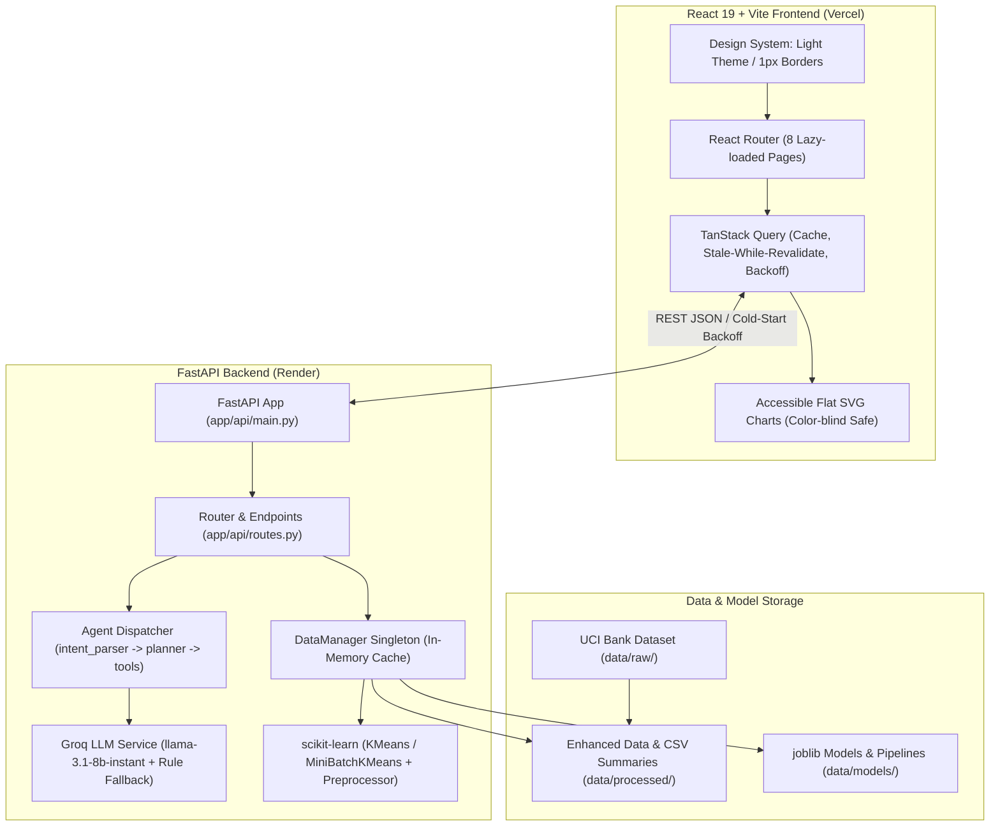

# Customer Segmentation Intelligence Console

A web application designed for retail bank analysts to explore customer segmentation, analyze behavioral and financial profiles, score prospective customers, and interact with an AI analyst assistant.

Built with **FastAPI**, **scikit-learn**, **React 19**, **Vite**, and **TanStack Query**.

---

## 1. System Architecture

The application couples a high-performance Python FastAPI backend for data engineering, clustering, and LLM tool execution with a responsive React frontend.



---

## 2. API Contract Specification

All endpoints are available under the `/api` prefix, with root-level aliases provided for backward compatibility.

| Method | Endpoint | Description | Request Body / Query Params | Response Type |
|---|---|---|---|---|
| `GET` | `/api/health` | Service health check and cold-start wake-up probe. | None | `HealthResponse` |
| `GET` | `/api/schema` | Dynamic feature metadata, types, ranges, and synthetic flags. | None | `DatasetSchemaResponse` |
| `GET` | `/api/segments` | Segment summaries, customer counts, percentages, and traits. | None | `SegmentsResponse` |
| `GET` | `/api/customers` | Searchable, sortable, paginated customer table with filters. | `page`, `page_size`, `search`, `segment`, `min_age`, `max_age`, `min_balance`, `max_balance`, `sort_by`, `sort_dir` | `CustomersListResponse` |
| `GET` | `/api/customers/{id}` | Detailed customer profile with why-this-segment explanation. | `id` (path parameter) | `CustomerDetailResponse` |
| `POST` | `/api/predict` | Live scoring of a customer profile with confidence and products. | `CustomerInput` JSON | `PredictResponse` |
| `GET` | `/api/model/evaluation` | Silhouette, Davies-Bouldin, Calinski-Harabasz, and curve points. | None | `ModelEvaluationResponse` |
| `GET` | `/api/eda` | Dynamic request-time distributions, missing values, correlations. | `metric` (`distributions`, `missing`, `correlations`, `overview`), `column`, `cluster` | `EDAResponse` |
| `POST` | `/api/chat` | AI analyst natural language chat with execution plan inspection. | `ChatRequest` (`query`) | `ChatResponse` |
| `POST` | `/api/datasets/upload` | Upload a new CSV dataset and detect column schemas. | `file` (multipart/form-data) | `UploadResponse` |
| `POST` | `/api/datasets/train` | Trigger background clustering pipeline for an uploaded dataset. | `TrainRequest` (`dataset_id`, `k`) | `PipelineStatusResponse` |
| `GET` | `/api/datasets/status/{job_id}` | Poll background clustering pipeline progress. | `job_id` (path parameter) | `PipelineStatusResponse` |

---

## 3. Frontend Pages

1. **Overview (`/`)**: High-level portfolio metrics, segment counts, solid flat horizontal distribution bar chart, and plain-language segment cards.
2. **Customers (`/customers`)**: Paginated, sortable directory with multi-attribute filtering (segment, age, balance range). Clicking any customer opens an accessible slide-out drawer disclosing full behavioral attributes, recommended products, and a "Why this segment" comparative analysis.
3. **Segments (`/segments`)**: Readable cards detailing persona profiles, segment sizes, comparative trait deviation bars vs portfolio averages, and targeted retention actions.
4. **Check a new customer (`/predict`)**: Dynamic form automatically constructed from `/api/schema` (no hard-coded field ranges). Returns predicted cluster, confidence score, assignment rationale, and personalized banking recommendations.
5. **Model quality (`/evaluation`)**: Evaluation diagnostics including Silhouette Coefficient, Davies-Bouldin Index, Calinski-Harabasz Score, cluster stability score, and SVG-rendered Elbow and Silhouette curves.
6. **Data insights (`/eda`)**: Request-time exploratory analysis allowing analysts to inspect distributions, missing values, and pairwise correlation matrices across the active dataset.
7. **Ask the assistant (`/chat`)**: Conversational agent interface with collapsible "How I got this" execution steps showing intent parsing and tool invocation.
8. **Data management (`/data`)**: CSV dataset upload zone, automatic column type detection, customizable K selection, background training progress bar, and active dataset switching.

---

## 4. Visual Rules & Design Standards

- **Theme**: Light theme only. Off-white background (`#f8f9fa`), white surface cards (`#ffffff`), and thin 1px borders (`#e2e8f0`).
- **Color Palette**: Solid flat colors. No gradients, glows, or glassmorphism. One primary accent (`#1d4ed8` muted blue) for actions and selection.
- **Color-Blind Safe Palette for Segments**:
  - Segment 0: `#2563eb` (Blue)
  - Segment 1: `#0d9488` (Teal)
  - Segment 2: `#d97706` (Amber)
  - Segment 3: `#7c3aed` (Violet)
  - Segment 4: `#ea580c` (Orange)
  - Segment 5: `#0284c7` (Sky)
- **Typography & Radii**: System font stack, 8px spacing scale, and 6-8px border radius.
- **Humanized Copy**: Colleague-like, plain-language text with zero marketing hype or placeholder numbers. Every loading, error, and empty state specifies what to do next.

---

## 5. Novelty & Limitations

### Real vs. Synthetic Attributes
- **Base Dataset**: The application builds upon the UCI Bank Marketing dataset containing 41,188 real banking campaign interactions from a Portuguese retail bank.
- **Synthetic Features**: Because the original UCI dataset does not record personal balance sheets, investment holdings, or mobile app usage, the following columns were **synthetically generated** to reflect a realistic modern retail banking environment:
  - `annual_income` (log-normal distribution scaled by occupation level)
  - `credit_score` (standard 300-850 credit range)
  - `account_balance` (correlated with income and age)
  - `digital_banking_score` (0-100 mobile/online adoption index)
  - `monthly_transactions` (transaction frequency count)
  - `investment_amount` (mutual funds, deposits, securities)
  - `account_tenure` (customer relationship duration in years)
  - `number_of_products` (breadth of products held)

These columns are clearly tagged with an `(is_synthetic: true)` flag in the API and displayed with a `(synthetic)` indicator across the user interface.

### Algorithmic Considerations
- **Scalability**: For datasets with more than 10,000 rows, the pipeline automatically switches to `MiniBatchKMeans` with batch size 1,024 to bound training latency and memory usage.
- **LLM Dependency**: The AI Assistant utilizes Groq's `llama-3.1-8b-instant` for tool calling and natural language synthesis. If the Groq API key is missing, expired, or rate-limited, the system seamlessly falls back to a deterministic rule-based agent with zero user disruption.

---

## 6. Local Setup & Development

### Prerequisites
- Python 3.10+
- Node.js 18+ and npm

### Backend Setup
```bash
# 1. Clone repository
git clone https://github.com/Tarun-03/customer-segmentation-agent.git
cd customer-segmentation-agent

# 2. Install Python dependencies
pip install -r requirements.txt

# 3. (Optional) Configure environment variables in .env
# GROQ_API_KEY=your_groq_api_key_here
# GROQ_MODEL_NAME=llama-3.1-8b-instant
# CORS_ORIGINS=http://localhost:5173,http://localhost:3000

# 4. Run automated test suite
python -m pytest tests/

# 5. Start FastAPI development server
uvicorn app.api.main:app --reload --port 8000
```

### Frontend Setup
```bash
# 1. Navigate to frontend directory
cd frontend

# 2. Install dependencies
npm install

# 3. Start Vite development server
npm run dev

# 4. Build for production
npm run build
```

---

## 7. Deployment Instructions

### Vercel Deployment (Frontend)
1. In the Vercel Dashboard, import the repository and set the **Root Directory** to `frontend`.
2. Framework Preset: **Vite**.
3. Build Command: `npm run build`.
4. Output Directory: `dist`.
5. Environment Variable:
   - `VITE_API_URL`: Your deployed FastAPI backend URL (e.g. `https://your-api.onrender.com`).

### Render Deployment (Backend)
1. In the Render Dashboard, create a new **Web Service** pointing to the repository.
2. Runtime: **Python 3**.
3. Build Command: `pip install -r requirements.txt`.
4. Start Command: `uvicorn app.api.main:app --host 0.0.0.0 --port $PORT`.
5. Environment Variables:
   - `GROQ_API_KEY`: Your Groq API key (optional).
   - `CORS_ORIGINS`: Your Vercel frontend URL (e.g. `https://customer-segmentation-agent.vercel.app`).